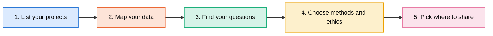
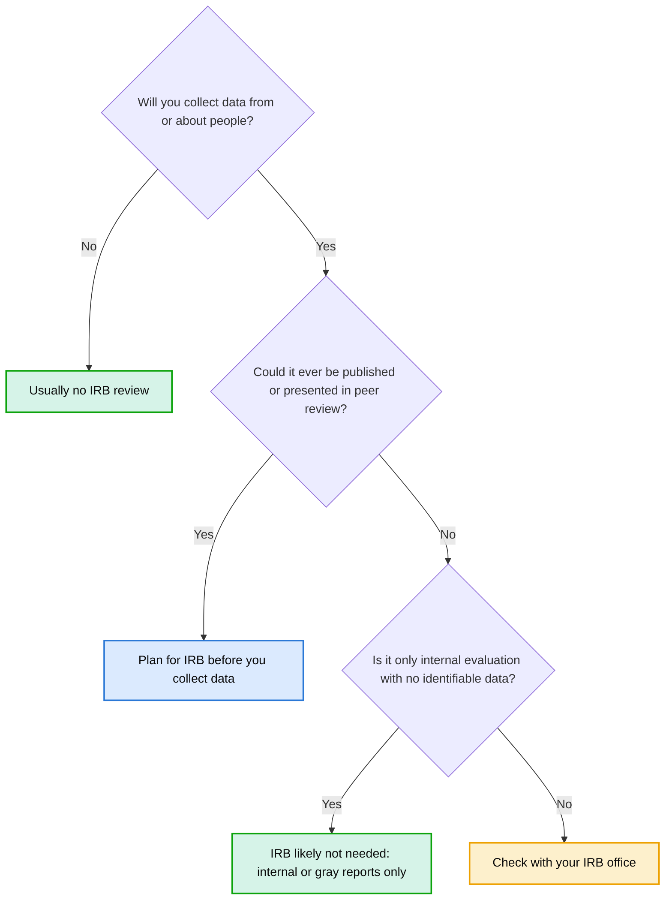

````markdown
# Turning Practice into Research

**A guide for doctoral students who work on several projects and collect many kinds of data.**

Created by Michelle Angelo-Rocha, Ph.D. · michelleangelorocha@gmail.com

Many doctoral students already sit on top of rich data: program records, surveys, interviews, field notes, community events. The challenge is knowing which project, question, and method to focus on, and how to turn everyday work into something you can publish and share.

## The Five Steps



1. **List your projects.** Name the programs, courses, and work you are already part of.
2. **Map your data.** Surveys, interviews, records, field notes: what already exists?
3. **Find your questions.** Descriptive, outcome, experience, design, long-term impact, and lessons learned.
4. **Choose methods and ethics.** Qualitative, quantitative, or mixed, and does it need IRB?
5. **Pick where to share.** Peer-reviewed articles, conference presentations, reports, policy briefs, toolkits, podcasts, and dashboards.

## Before You Collect Any Data



- Could this ever become a peer-reviewed article, a peer-reviewed conference presentation, a book chapter, or a dissertation? Most of these require IRB approval.
- Will I collect information from or about people?
- Could anyone be identified from the data?
- Who owns the data, and who needs to give permission to use it?
- Have I checked with my IRB office about what kind of review this needs?

**Takeaway:** If there is any chance your work will be published, plan for IRB from the start. Rules differ between institutions, so your IRB office makes the final decision.

## How This Guide Was Made

This guide is based on my own experience turning applied program work into research and on a research mapping framework I developed. I used AI (Claude, by Anthropic) as a writing and design assistant to organize and clarify the content. All ideas, structure decisions, and final edits are my own.

## License

Shared under a Creative Commons Attribution 4.0 International License (CC BY 4.0). You may share and adapt it with credit:

Angelo-Rocha, M. (2026). *Turning practice into research: A guide for doctoral students.*
````
