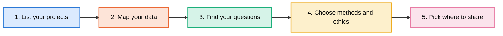
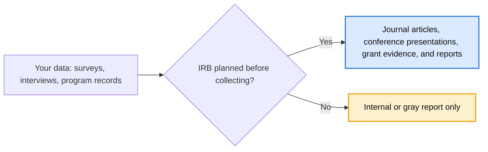

# Practice to Research Toolkit

**Turning everyday program work into research, with ethics and planning from the start.**

Created by Michelle Angelo-Rocha, Ph.D. · michelleangelorocha@gmail.com

Many programs, organizations, and students already collect valuable data: surveys, interviews, program records, and feedback. With the right planning, that work can become peer-reviewed articles, conference presentations, and evidence for future funding. Without it, the same data often stays in an internal report. This toolkit helps two groups plan ahead.

## Choose Your Path

### [For Student Researchers](students/)
A five-step guide for student researchers at any level, from undergraduate and master's to doctoral, with an IRB flowchart and a printable one-page handout.

### [For Leaders](leaders/)
A five-minute guide for leaders who are not researchers: why planning for IRB before collecting data protects your participants, your organization, and the value of your data.

## About This Toolkit

This toolkit is based on my experience turning applied program work into research and partnering with leaders and organizations. I used Claude (by Anthropic) as a thinking partner to brainstorm ideas and help design the visuals. All decisions were my own.

## License

Shared under a [Creative Commons Attribution 4.0 International License (CC BY 4.0)](https://creativecommons.org/licenses/by/4.0/).
