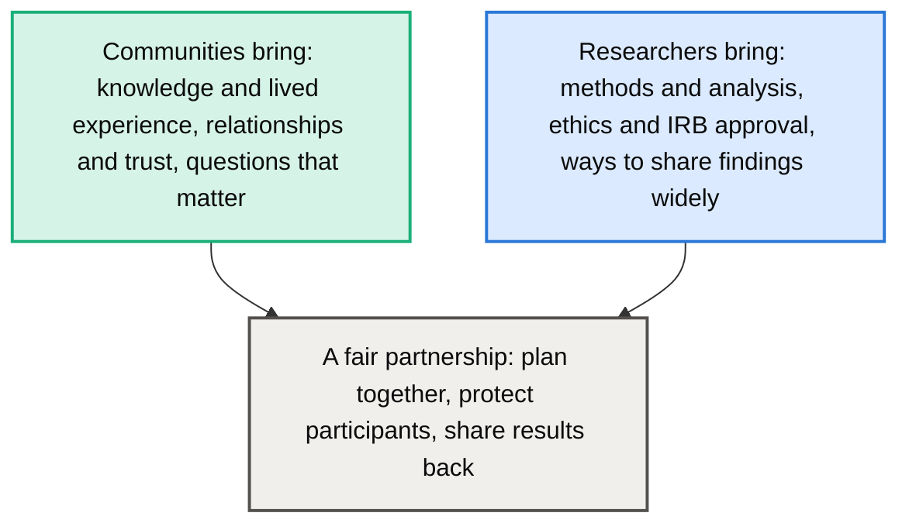
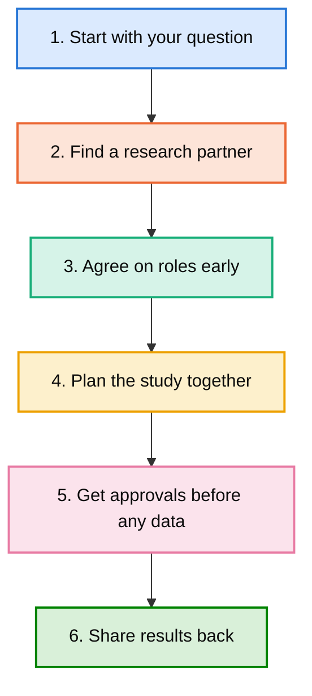

# Research Partnerships for Communities: Know Your Rights and Your Voice

**A guide for schools, community organizations, and families who are invited to take part in research, or who want to start a project with researchers.**

Created by Michelle Angelo-Rocha, Ph.D. · michelleangelorocha@gmail.com

-**One-page handouts:** [English](know-your-rights-english.pdf.pdf) · [Guía de una página en español](conozca-sus-derechos-espanol.pdf.pdf) · [Guia de uma página em português](conheca-seus-direitos-portugues.pdf.pdf)

Researchers often invite communities to share their knowledge and experiences. Good research should be a partnership, not something done *to* a community. Your knowledge, time, and stories have value, and you have the right to ask questions, set conditions, and say no.

## What Is Research, and What Is an IRB?

Research is a planned way of learning something new by collecting information, such as surveys, interviews, or observations. When research involves people, an Institutional Review Board (IRB) reviews the plan to make sure it is ethical and protects participants. The IRB is there to protect you.

## Your Rights as a Participant

- **You can say no.** Taking part is always your choice.
- **You can stop at any time,** even in the middle of an interview or survey, with no penalty.
- **You can skip any question** you do not want to answer.
- **You should understand the study** in plain language, and in your preferred language when possible.
- **Your information should be protected** and kept private.
- **You can ask how the results will be used** and who will see them.

## Questions to Ask Before You Say Yes

| Question | Why it matters |
| --- | --- |
| Has this study been approved by an IRB? | Approval means the plan was reviewed for ethics and safety. |
| What is the study about, and why us? | You deserve to know the purpose and why your community was chosen. |
| What will we be asked to do, and how long will it take? | Your time is valuable. |
| Is information available in our language? | Everyone should be able to understand and decide for themselves. |
| How will our information be protected? | Ask where data is stored, who can see it, and whether names are removed. |
| How will the results be shared with us? | Results should come back to the community, not only to journals. |
| What does our community gain? | A fair partnership benefits both sides. |

## What a Fair Partnership Looks Like

- **Plans together.** The community helps shape the questions from the start.
- **Respects time and knowledge.** Participants are recognized for their contributions.
- **Uses accessible language.** Materials are clear and offered in the languages people speak.
- **Shares results back.** Findings are returned in a useful, understandable form.
- **Builds trust over time.** The relationship continues beyond one study.

## Warning Signs

- No one can tell you whether the study has IRB approval.
- You feel pressured to agree quickly.
- The purpose is unclear, or keeps changing.
- No one explains how your information will be protected.
- No plan to share results with your community.

If you see these signs, it is okay to pause, ask more questions, or decline.

## Have an Idea for a Research Project?

Your community does not have to wait to be invited. If you have a question you want answered, or a program you want to understand better, you can reach out to researchers yourself. Knowing your rights and the research process helps you make informed decisions and lead as an equal partner.

- **Start with your question.** What do you want to learn, and why does it matter to your community?
- **Find a research partner.** Universities and researchers often look for community partners.
- **Agree on roles early.** Decide together who leads what, who owns the data, and how results will be shared.
- **Plan for IRB from the start.** If the work may be published or presented, the research partner will need IRB approval before any data is collected.

### Not Part of a University? Where IRB Review Comes From

| Option | How it works | Cost to your organization |
| --- | --- | --- |
| Partner with a university researcher | The researcher's university IRB reviews the study. Sometimes your organization signs an agreement to rely on that IRB. | Usually none. This is often the best path. |
| Use an independent IRB | Some IRBs are not tied to a university and review studies for any organization. | A fee, which can be costly for small organizations. |
| Your own review process | School districts and hospitals often have their own research approval process, required in addition to IRB. | Varies |

**Tip:** Partnering with a university researcher gives you IRB review, research expertise, and a path to publication, often at no cost to your community.

## Let's Build Research Together

Communities and researchers learn more when they work as partners. If your school, organization, or family has been invited to take part in research, or you want to explore a research partnership, I am happy to talk.

**Michelle Angelo-Rocha, Ph.D.** · michelleangelorocha@gmail.com

## How This Guide Was Made

This guide is based on my experience in community-based research. I used Claude (by Anthropic) as a thinking partner to brainstorm ideas and help design the visuals. All decisions were my own.

## License

Shared under a [Creative Commons Attribution 4.0 International License (CC BY 4.0)](https://creativecommons.org/licenses/by/4.0/). Angelo-Rocha, M. (2026). *Research partnerships for communities: Know your rights and your voice.*
