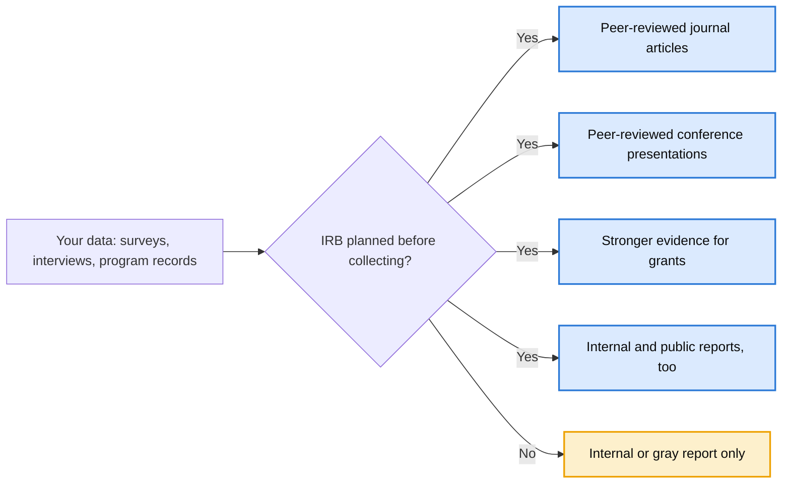
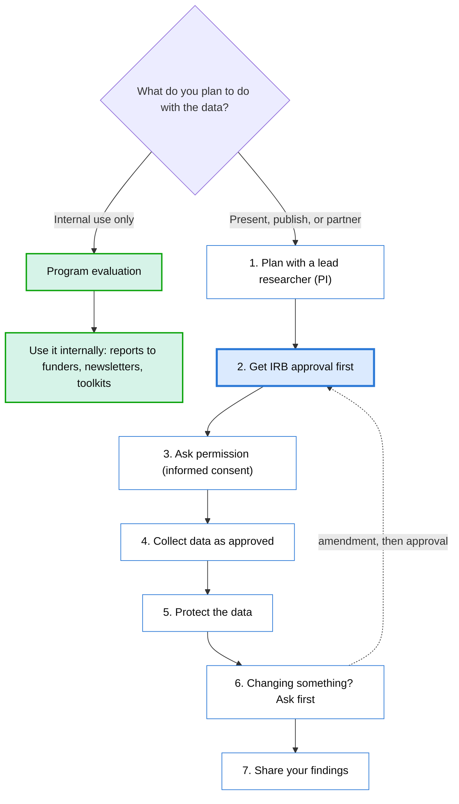

# IRB for Leaders: Protect the Value of Your Data

**A five-minute guide for leaders who are not researchers.**

Created by Michelle Angelo-Rocha, Ph.D. · michelleangelorocha@gmail.com

Your organization already collects valuable data: surveys, interviews, program records, feedback. Planning for IRB before you collect it decides whether that data can only stay in an internal report, or whether it can also become publications, conference presentations, and evidence for future funding.

The survey, the interviews, and the work are the same either way. Only the planning is different.

## What Is an IRB, in One Sentence?

An Institutional Review Board (IRB) is the office that reviews projects involving people to make sure they are ethical and protect participants' privacy. Most universities have one.

## Why Leaders Should Care

| Without IRB planning | With IRB planning |
| --- | --- |
| Findings stay in internal or gray reports | Findings can also be published in peer-reviewed journals |
| Cannot present at peer-reviewed research conferences | Can present at research conferences |
| Weaker evidence for grant proposals | Stronger evidence for grants and partnerships |
| Data is hard to reuse later | Data can support future studies and reports |
| Less visibility for the organization | More visibility and credibility for the organization's work |

**The key point:** IRB approval is decided before data is collected. Once the data exists, it is very hard to publish it as research.

## A Real Lesson

An organization surveyed and interviewed managers and HR staff about an important workforce issue. The findings were strong, but no one planned for IRB before collecting the data. The work could only become a gray report, not a peer-reviewed article or conference presentation. The same effort, with a few weeks of planning, could have produced both.

## The One Question to Ask

Before any survey, interview, or evaluation begins, ask your team:

> **"Is there any chance we will want to publish or present this?"**

- **Yes or maybe:** Contact the IRB office before collecting data.
- **No, internal use only:** IRB review is likely not needed, but the findings stay internal.

## The Research Roadmap

If you plan to present, publish, or partner with researchers, every step below happens in this order. If anything changes along the way, such as a new survey question or a new group of participants, the IRB must approve the change before you make it.

## Protecting Participants and Their Data

Trust is the foundation of research with people. How you ask permission, where you store data, and which tools you use all matter, and the IRB will ask about each one.

| Area | What to think about before you start |
| --- | --- |
| Permission | Explain the study in plain language. People must choose freely, can say no, and can stop at any time. |
| What you collect | Collect only what you need. Avoid names and identifying details unless they are truly necessary. |
| Where you store it | Use storage your institution approves, with encryption and password protection. Avoid personal laptops, personal email, and personal cloud accounts. |
| Third-party tools | Survey platforms, video calls, transcription services, and AI tools may store or process data on outside servers. Check that each tool is approved before you use it. |
| Who can access it | Limit access to the approved research team only. |
| De-identifying | Replace names with codes, and keep the key that links codes to names separate and secure. |
| Sharing results | Report findings so no individual can be recognized, especially in small groups. |
| Keeping and deleting | Follow your IRB's rules for how long to keep data and how to delete it safely. |

**Remember:** A data breach or a broken promise to participants can damage your organization's reputation far more than any delay from planning ahead.

## What It Takes

- A responsible researcher, called the Principal Investigator (PI), who leads the study and is accountable to the IRB. The PI usually must complete human subjects training, and many institutions require the PI to be faculty or approved staff, so check your IRB's rules. If your team has no researcher, bring one in at the planning stage, before you design a survey or collect any data. A researcher cannot rescue data that was collected without IRB approval.
- A short project description: who you will survey or interview, what you will ask, and how you will protect their privacy.
- A review period, which varies by institution and type of review, so plan ahead.

## Questions to Ask Your Team

- What data are we collecting now, or planning to collect?
- Could any of it become a publication, presentation, or grant evidence?
- Can anyone be identified from the data?
- Who on our team can work with the IRB office?

## Let's Work Together

Good research is a partnership. Leaders bring the programs, the community relationships, and the real-world questions. Researchers bring the methods, the ethics, and the IRB process. When we plan together from the start, we protect participants, strengthen your organization, and turn your work into lessons others can learn from. If you are planning a survey, interviews, or an evaluation, let's talk before you begin.

**Michelle Angelo-Rocha, Ph.D.** · michelleangelorocha@gmail.com

## How This Guide Was Made

This guide is based on my experience helping organizations turn program work into research. I used Claude (by Anthropic) as a thinking partner to brainstorm ideas and help design the visuals. All decisions were my own.

## License

Shared under a [Creative Commons Attribution 4.0 International License (CC BY 4.0)](https://creativecommons.org/licenses/by/4.0/). Angelo-Rocha, M. (2026). *IRB for leaders: Protect the value of your data.*
